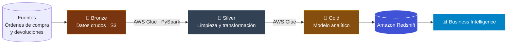

<!--
  JOSE MANUEL SANCHEZ SALDAÑA
  CLOUD / DATA / BACKEND ENGINEERING PORTFOLIO
-->

<div align="center">


<a href="https://josemanuel11sans.github.io/josemanuel11sans/">

</a>

<br/>


<br/><br/>


</div>

<br/>


<br/>

## 👨‍🚀 SOBRE MÍ

<table>
<tr>
<td width="62%" valign="top">

Soy **José Manuel Sánchez Saldaña**, desarrollador de software especializado en **backend con Python** y **soluciones en AWS**.

🔹 Diseño e implemento **procesos ETL** con **AWS Glue** y **Amazon Redshift**.
🔹 Desarrollo **APIs y servicios** para aplicaciones web y móviles.
🔹 He participado en proyectos empresariales para **Palacio de Hierro, Volaris, Jugos del Valle e izzi**.
🔹 Estudio Ingeniería en Desarrollo y Gestión de Software en **UTEZ**.
🔹 Co-fundador de **[Kyloo](https://kyloo.com.mx)**, donde construimos software a la medida.

</td>
<td width="38%" valign="top">

```yaml
developer:
  name: José Manuel Sánchez
  role: Software Developer
  focus:
    - Backend Engineering
    - Cloud Computing
    - Data Engineering
  cloud: AWS
  languages:
    - Python
    - Java
    - TypeScript
  status: building 🚀
```

</td>
</tr>
</table>

<br/>

## 🪐 STACK TECNOLÓGICO

<div align="center">


<br/><br/>

| ÓRBITA | TECNOLOGÍAS |
|:---:|:---|
| ☀️ **Lenguajes** | `Python` `Java` `JavaScript` `TypeScript` `SQL` |
| 🛰️ **Frameworks** | `Spring Boot` `React` `Express` `Electron` `PySpark` |
| ☁️ **AWS** | `EC2` `S3` `RDS` `Amplify` `Lambda` `Route 53` `VPC` |
| 🌙 **Data** | `Glue` `Redshift` `Athena` `PySpark` `Medallion Architecture` |
| 🪨 **Bases de datos** | `MySQL` `PostgreSQL` `MongoDB` |
| 🚀 **DevOps** | `Docker` `Linux` `GitHub` `GitLab CI/CD` `Azure DevOps` |

</div>

<br/>

## ☁️ AWS — SERVICIOS CON LOS QUE HE TRABAJADO

<div align="center">


<br/>


</div>

### 🏗️ Arquitectura Medallion que implementé en EPH Fluent



<br/>

## 🚀 BITÁCORA DE MISIONES — PROYECTOS DESTACADOS

<table>
<tr>
<td width="50%" valign="top">

### 🪐 01 · EPH Fluent
**Palacio de Hierro**

Modernización de una plataforma de datos para el área de **Business Intelligence**.

- ETL con **AWS Glue**
- **Arquitectura Medallion**
- Órdenes de compra y devoluciones
- Integración con **Amazon Redshift**

`Python` `AWS Glue` `Redshift`

</td>
<td width="50%" valign="top">

### 🌎 02 · Pipeline DNR
**Volaris**

Rediseño del pipeline de datos para el cálculo de impuestos de pasajeros.

- Integración y transformación de datos
- Cálculo de **DNR, TUA y No Show**
- Pasajeros nacionales, extranjeros, residentes e infantes
- Datos confiables para el equipo de BI

`AWS` `ETL` `Data Engineering`

</td>
</tr>
<tr>
<td width="50%" valign="top">

### 🌑 03 · Reconocimiento de Piezas
**Jugos del Valle**

Backend de una aplicación interna para reconocer y dar seguimiento a piezas en almacén mediante fotografías.

- Backend en **Python**
- Lógica de negocio por escenarios
- Reconocimiento basado en imágenes

`Python` `Backend`

</td>
<td width="50%" valign="top">

### ☀️ 04 · Sistema Fotovoltaico
**Hexa Solar Power Solutions**

Aplicación web para el cálculo de sistemas fotovoltaicos en un entorno real.

- API REST con **Spring Boot**
- **React + TypeScript**
- **MySQL**
- Integración con **NASA POWER**

`Java` `React` `MySQL`

</td>
</tr>
</table>

<br/>

## 🛰️ TRAYECTORIA

```text
2023 ─── 🎓 Inicio TSU en TI · UTEZ
  │
2025 ─── 💼 Xal Digital (Ene 2025 – Jun 2026)
  │       ├─ Palacio de Hierro · Volaris · Jugos del Valle · izzi
  │       └─ 🌞 Hexa Solar Power Solutions (May – Ago 2025)
  │
2025 ─── 🎓 Ingeniería en Desarrollo y Gestión de Software · UTEZ
  │
2026 ─── 🚀 Co-Founder en Kyloo  ◄── estás aquí
```

<div align="center">

### 🛸 POSICIÓN ACTUAL

<a href="https://kyloo.com.mx">

</a>

*Software a la medida y soluciones tecnológicas.*

</div>

<br/>

## 🎓 FORMACIÓN Y CERTIFICACIONES

**Universidad Tecnológica Emiliano Zapata — UTEZ**

- 📘 Ingeniería en Desarrollo y Gestión de Software · 2025 – 2027 *(en curso)*
- 📗 TSU en Tecnologías de la Información, Desarrollo de Software Multiplataforma · 2023 – 2025

<div align="center">


<br/>


<br/>


</div>

**🌐 Idiomas:** Español (nativo) · Inglés (B1–B2)

<br/>

## 📡 TELEMETRÍA DE GITHUB

<div align="center">


<br/>


<br/><br/>


</div>

<br/>

## 🌠 ESTABLEZCAMOS CONEXIÓN

<div align="center">

<a href="mailto:sanchezsaldana89@gmail.com">

</a>
<a href="https://github.com/josemanuel11sans">

</a>
<a href="https://josemanuel11sans.github.io/josemanuel11sans/">

</a>
<a href="https://kyloo.com.mx">

</a>

<br/><br/>

**DE LA TIERRA A LA NUBE ☁️**

`BUILD · INNOVATE · DEPLOY`


</div>
