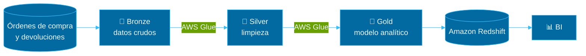

 

  

## Hola, soy José Manuel ✦

- **Software Developer** enfocado en backend, cloud y data engineering, con Python y **AWS**.
- Diseño e implemento **procesos ETL** con **AWS Glue** y **Amazon Redshift**.
- Participé en proyectos para **Palacio de Hierro, Volaris, Jugos del Valle e izzi** en **Xal Digital** (ene 2025 – jun 2026).
- **Co-Founder** de **[Kyloo](https://kyloo.com.mx)**: software a la medida y soluciones tecnológicas.
- Estudiante de **Ingeniería en Desarrollo y Gestión de Software** en UTEZ.
- Español (nativo) · Inglés (B1–B2).

  
   
  <b>AWS Cloud</b> · Glue, Redshift, Athena, Lambda &nbsp;|&nbsp; <b>Backend</b> · Python, Java, Spring Boot &nbsp;|&nbsp; <b>Data/ETL</b> · Medallion, PySpark &nbsp;|&nbsp; <b>Full Stack</b> · React, TypeScript, Node &nbsp;|&nbsp; <b>DevOps</b> · Docker, Linux, GitLab CI

## 🪐 Proyecto principal · EPH Fluent

**Palacio de Hierro** · Modernización de una plataforma de datos para el área de **Business Intelligence**: ETL con AWS Glue, arquitectura Medallion e integración de órdenes de compra y devoluciones en Amazon Redshift.

`Python` `AWS Glue` `Amazon Redshift` `Medallion Architecture` `PySpark`

## Más proyectos

<table>
<tr>
<td width="50%" valign="top">

### 🌎 Modernización DNR · Volaris

Rediseño del pipeline de datos para calcular impuestos **DNR, TUA y No Show** (pasajeros nacionales, extranjeros, residentes e infantes), entregando datos confiables al equipo de BI.

`AWS` `ETL` `Data Engineering`

</td>
<td width="50%" valign="top">

### 🌑 Reconocimiento de piezas · Jugos del Valle

Backend en **Python** para una app interna que reconoce y da seguimiento a piezas en almacén mediante fotografías, con la lógica de negocio de cada escenario.

`Python` `Backend`

</td>
</tr>
<tr>
<td width="50%" valign="top">

### ☀️ Sistema fotovoltaico · Hexa Solar

Aplicación web de cálculo fotovoltaico para un entorno real (E.S.I.E.S / Hexa Solar Power Solutions, may – ago 2025). API REST con integración a **NASA POWER**.

`Spring Boot` `React` `TypeScript` `MySQL`

</td>
<td width="50%" valign="top">

### 🚀 Kyloo · Co-Founder

Construcción de software a la medida y soluciones tecnológicas para clientes.

</td>
</tr>
</table>

## Certificaciones y stack

 

  

  

<b>GitHub stats</b> (click)

 

<picture>
  <source media="(prefers-color-scheme: dark)" srcset="https://raw.githubusercontent.com/joseman11/joseman11/output/github-contribution-grid-snake-dark.svg" />
  <source media="(prefers-color-scheme: light)" srcset="https://raw.githubusercontent.com/joseman11/joseman11/output/github-contribution-grid-snake.svg" />
  
</picture>

